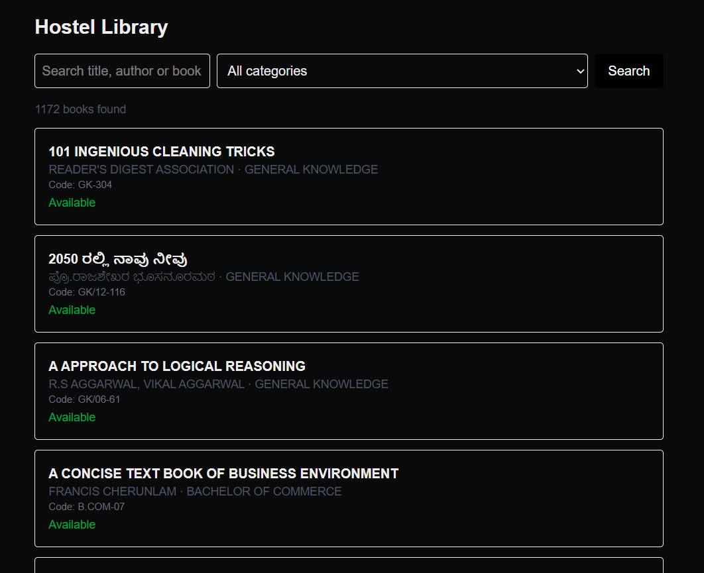
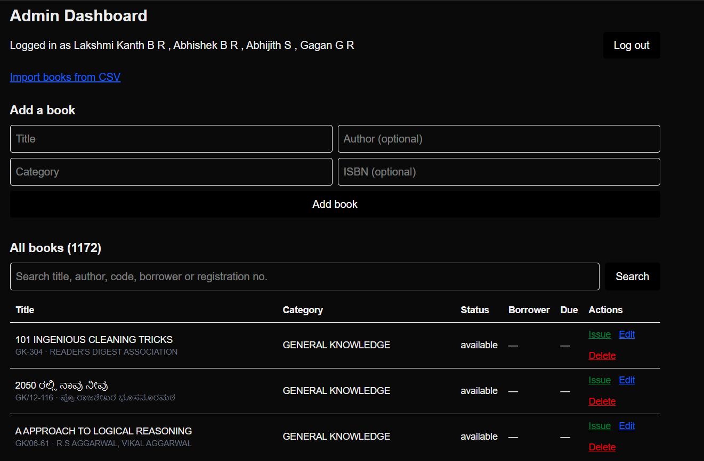
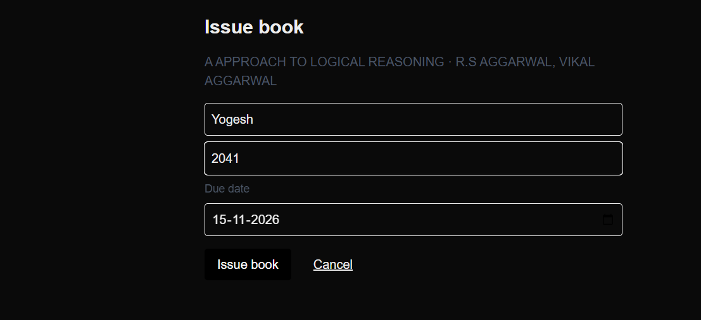

# Digi Library

A hostel library management website. Approved hostel residents can search the whole book collection, see which books are available or when they are due back, and check their own borrowed books. The library committee manages books, loans, student requests and admin accounts from a protected dashboard.

**Live site:** [https://digi-library-one.vercel.app/](https://digi-library-one.vercel.app/)
(The catalog is for approved students and admins, so the live site asks for a login. See the screenshots below for a tour.)

## Screenshots

### Catalog


### Admin dashboard


### Issue a book


## Why this project exists

The hostel library holds more than 1,100 books and is run by a student library committee. Students had to walk to the library to find out whether a book existed or was free, and the committee tracked borrowers by hand. Digi Library replaces that with a searchable website and a fast issue/return workflow, built around a real register of 1,172 books that was converted from a scanned paper register into clean data.

## Features

**For students**
- Request access with a registration number, name and password (and an optional hostel code); the committee approves each request
- Search by title, author or book code, filter by category, paginated results
- Availability at a glance: available, borrowed (with due date), or not available
- "My books" page: books borrowed now, due dates, overdue flag and history
- Kannada titles work end to end (UTF-8)
- Borrower names are never shown to other students

**For the committee (admin dashboard)**
- Login with hashed passwords, rate limiting and one active session at a time
- Add, edit and delete books; mark books lost, found or unverified; remarks
- Issue and return books using database transactions; overdue list
- Student requests: approve, reject, block, reset a student's password
- Loan history with filters, and reports (most borrowed books, loans by category and month)
- Bulk CSV import (validated, all-or-nothing, safe to repeat) and CSV export of books and loans
- Manage admin accounts: change password, add and deactivate admins
- Audit log of who did what and when

## Tech stack

| Layer | Technology |
|---|---|
| Framework | Next.js 16 (App Router, Server Components, Server Actions) |
| Language | TypeScript |
| Styling | Tailwind CSS |
| Database | MySQL 8 using the `mysql2` driver and raw parameterized SQL |
| Auth | `bcryptjs` password hashing; `httpOnly` session cookies (admins: one session; students: hashed tokens, 30 days) |
| CSV | PapaParse |
| Hosting | Vercel (app) and Aiven free MySQL (database) |

## How it works

```
Browser
  |  GET /?q=habit&genre=Self-Help&page=2
  v
Next.js (Server Components render on the server)
  |  parameterized SQL through a connection pool (TLS, certificate verified)
  v
MySQL
```

- **Reading:** server components query MySQL directly, so no database code reaches the browser.
- **Writing:** forms call Server Actions. Every action checks the session on the server, validates the input, runs parameterized SQL, refreshes cached pages with `revalidatePath`, and redirects with a status message.
- **Issue and return:** run inside a transaction. The issue step uses a conditional update (`WHERE status = 'available'`) and checks `affectedRows`, so two admins can never issue the same book at the same moment.
- **Secure by default:** the catalog needs an approved student or admin login unless `PUBLIC_CATALOG=true` is set.

## Database design

| Table | Purpose |
|---|---|
| `books` | One row per physical copy: unique `book_code`, title, author, category, price, donated, remarks, status, due date |
| `loans` | One row per issue: book, borrower name and registration number, issue/due/return dates, and which admin issued it |
| `admins` | Committee accounts: username, bcrypt hash, active flag and the single allowed session id |
| `students` | Access requests and accounts: registration number, name, bcrypt hash, status (`pending`, `approved`, `rejected`, `blocked`) |
| `student_sessions` | Student sessions: only a SHA-256 hash of the token is stored, with an expiry |
| `login_attempts` | Failed and successful logins, used for rate limiting |
| `audit_log` | Append-only record of admin actions |

Book statuses: `available`, `borrowed`, `lost`, `unverified`. A loan with `return_date IS NULL` is still open. The full schema is in [`database/schema.sql`](database/schema.sql).

## Security notes

- Passwords are stored only as bcrypt hashes; student session tokens are stored only as SHA-256 hashes
- Cookies are `httpOnly`, `sameSite=lax` and `secure` in production
- Admins: one active session at a time; a new login invalidates the old one
- Login rate limiting: 5 failed attempts per username (or 30 per IP) in 15 minutes locks logins for that window, with separate counters for students so they can never lock out admins
- A dummy password hash and generic messages stop the login from revealing which usernames exist
- All queries use `?` placeholders; filters that change the query shape are checked against whitelists
- Authorization is checked on the server in every page, action and route handler, not just by hiding buttons
- The database connection uses TLS and can verify the provider's CA certificate
- Optional hostel code so only residents can request access, plus admin approval of every request
- Append-only audit log; `robots.txt` and `noindex` keep search engines away
- Secrets live in environment variables and are never committed

## Project structure

```
app/
  page.tsx                       catalog (login required by default)
  login/, register/, my-books/   student pages
  student-actions.ts             request access, log in, log out
  api/books/route.ts             JSON API for the catalog (login required)
  error.tsx, not-found.tsx, robots.ts
  admin/
    page.tsx                     dashboard
    login/, import/, admins/, students/, loans/, reports/, audit/
    books/[id]/edit and issue    book forms
    export/books, export/loans   CSV downloads
    actions.ts                   admin login and logout
    book-actions.ts              add, update, delete
    loan-actions.ts              issue and return (transactions)
    import-actions.ts            CSV import
    admin-actions.ts             change password, add and deactivate admins
    students-actions.ts          approve, reject, block, reset password
components/                      Pager, DeleteButton
lib/                             db, queries, auth, student-auth, rate-limit, audit, csv, dates
database/schema.sql              table definitions
scripts/                         create-admin.mjs, check-db.mjs
```

## Run it locally

Requirements: Node.js 20.6 or newer and MySQL 8.

```bash
git clone https://github.com/Yogeshbn2008/digi-library.git
cd digi-library
npm install
```

1. Create the tables by running [`database/schema.sql`](database/schema.sql) in MySQL.
2. Create a `.env.local` file in the project root:

```
DB_HOST=localhost
DB_PORT=3306
DB_USER=root
DB_PASSWORD="your-mysql-password"
DB_NAME=digilibrary
```

Quote the password if it contains `#`. Optional settings:

| Variable | Purpose |
|---|---|
| `DB_SSL=true` | Use TLS (needed for most hosted databases) |
| `DB_CA` | The provider's CA certificate text, to verify the server |
| `JOIN_CODE` | A hostel code students must enter when requesting access |
| `PUBLIC_CATALOG=true` | Make the catalog visible without a login (leave unset to require login) |

3. Create the first admin account:

```bash
node --env-file=.env.local scripts/create-admin.mjs
```

4. Start the app:

```bash
npm run dev
```

Open http://localhost:3000. Students use `/login`; the committee signs in at `/admin/login`. For a quick local look at the catalog without creating a student, set `PUBLIC_CATALOG=true` in `.env.local`.

## CSV import format

Upload a UTF-8 CSV from the admin dashboard with these columns:

```
book_code,title,author,category,price,donated,status,remarks
```

- Required: `book_code`, `title`, `category`
- `status` can be `available`, `lost` or `unverified`
- `donated` can be `0`/`1` or `yes`/`no`
- Rows whose `book_code` already exists are skipped, so uploading the same file twice is safe
- If any row is invalid, nothing is imported and the line numbers are reported

## Deployment

- **App:** Vercel, connected to this repository so every push to `main` redeploys. The function region is set close to the database.
- **Database:** Aiven free MySQL. Connection settings and secrets are environment variables in the Vercel project (secrets are stored as Secret type).
- Free database tiers can power off after long inactivity, so check the provider console if a database error appears. A friendly error page explains problems to visitors.
- Deployment order matters when code and database change together: create new tables first, then push the code that uses them.

## Roadmap

- [x] Catalog with search, categories and pagination
- [x] Admin login with rate limiting and a single active session
- [x] Add, edit, delete and status editing for books
- [x] Issue and return with transactions, overdue list
- [x] CSV import and export
- [x] Loan history, reports and audit log
- [x] Admin account management
- [x] Student accounts with admin approval and a "My books" page
- [x] Deployment with verified TLS
- [ ] Automated tests and a CI workflow
- [ ] Overdue reminders and book reservations
- [ ] Two-factor sign-in for admins

## Known limitations

- Loans are linked to students by registration number typed by the admin, not by a foreign key
- One physical copy per row, tracked by its book code
- Titles and authors are kept exactly as written in the original register, including its spelling mistakes
- Hosted on free tiers, so occasional downtime is possible

## Author

Built by Yogesh B N, B.Tech engineering student, as a real tool for the hostel library committee.